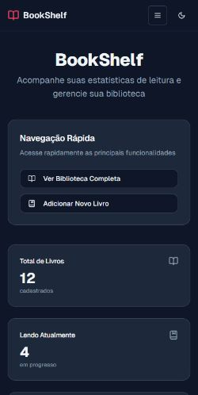
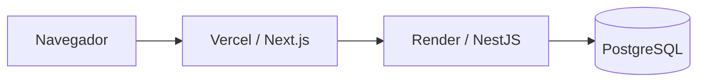

# BookShelf

Aplicação web para organizar uma biblioteca pessoal, acompanhar leituras e visualizar o progresso da coleção.

[Demo](https://bookshelf-mobr.vercel.app/) · [API / Swagger](https://db-bookshelf.onrender.com/api) · [Repositório do backend](https://github.com/viitorlimaa/db-bookshelf)



## Visão geral

O BookShelf centraliza o cadastro e o acompanhamento de livros em um painel simples e responsivo.

- Cadastro, edição e exclusão de livros.
- Dashboard com quantidade de livros, leituras em andamento, finalizados e páginas lidas.
- Busca e filtros combináveis por gênero e status, refletidos na URL.
- Tema claro, escuro e conforme o sistema.

## Stack

| Frontend | Qualidade | Infraestrutura |
| --- | --- | --- |
| Next.js 14 (App Router), TypeScript, Tailwind CSS 4, shadcn/Radix | Vitest, ESLint, TypeScript | Vercel |

## Arquitetura



- Server Components lêem da API com cache de 60 s e tags por coleção ou livro.
- Server Actions criam, editam e excluem registros e invalidam o cache afetado.
- Leituras têm timeout de 8 s e um error boundary informa quando o servidor está acordando.
- O backend gratuito no Render pode dormir; o workflow de keep-alive consulta `/health`.
- Biblioteca carregada no servidor; filtros são aplicados no cliente e preservados na URL.

## Rodando localmente

Pré-requisitos: Node.js 20+ e backend PostgreSQL/NestJS disponível. Siga a [configuração do backend](https://github.com/viitorlimaa/db-bookshelf#readme).

```bash
git clone https://github.com/viitorlimaa/bookshelf.git
cd bookshelf
cp .env.example .env.local
npm ci
npm run dev
```

No PowerShell: `Copy-Item .env.example .env.local`.

| Variável | Obrigatória | Valor |
| --- | --- | --- |
| `NEXT_PUBLIC_API_BASE` | Sim | `http://localhost:3001` ou a URL pública da API |

Acesse `http://localhost:3000`.

## Scripts

| Comando | Função |
| --- | --- |
| `npm run dev` | Servidor de desenvolvimento |
| `npm run build` | Build de produção |
| `npm run start` | Servidor do build |
| `npm run lint` | ESLint |
| `npm run typecheck` | Verificação TypeScript |
| `npm test` | Testes Vitest |

## Testes e CI

Os testes cobrem regras puras de estatísticas, progresso, normalização de dados e filtros combináveis. A CI de pull requests valida typecheck, testes, lint e build em Node.js 20, bloqueando alterações que falhem em qualquer etapa.

## Decisões técnicas

- **Data Cache com tags — menos chamadas à API — trade-off:** dados podem esperar até 60 s, apesar da invalidação imediata após mutações.
- **Server Actions como repasse para a API — validação no formulário e no backend — trade-off:** dependem da API remota e não oferecem reprocessamento offline.
- **Filtros na URL — navegação compartilhável — trade-off:** alteração de parâmetro gera nova navegação e o debounce da busca adiciona 400 ms.
- **Vitest para regras puras — testes rápidos e isolados — trade-off:** não substitui testes de integração com o backend.

## Limitações conhecidas

- O primeiro acesso à API pode demorar quando o serviço gratuito está acordando.
- Não há autenticação de usuário neste frontend.
- A coleção pública aceita operações de escrita sem login; o backend é responsável pela API.
- Não há paginação: a biblioteca atual carrega toda a coleção.
- O serviço gratuito não garante disponibilidade contínua nem baixa latência.

## Licença

Este repositório não declara uma licença no momento.
